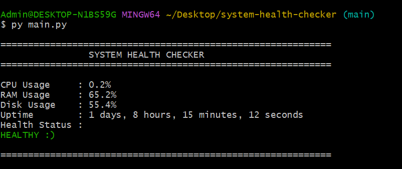

# System Health Checker

A simple Python CLI tool that monitors basic system health information.

## Features

* CPU usage
* RAM usage
* Disk usage
* System uptime
* Health status warnings
* Terminal colors and status icons (using ansi escape codes)

## Installation

Clone the repository:

```bash
git clone https://github.com/Mubaraq-Ay/system-health-checker.git
```

Install the required dependency:

```bash
pip install -r requirements.txt
```

## Usage

Run the program:

```bash
python main.py
```

## Preview



> **Note:** The disk usage path is currently configured manually in the source code. Update the path in `system_info.py` to match the disk/drive you want to monitor on your machine.

## Project Structure

```text
system-health-checker/
├── screenshots
├── main.py
├── system_info.py
├── health.py
├── display.py
├── ansi_escape_codes.py
├── requirements.txt
└── .gitignore
```

Happy coding :)
